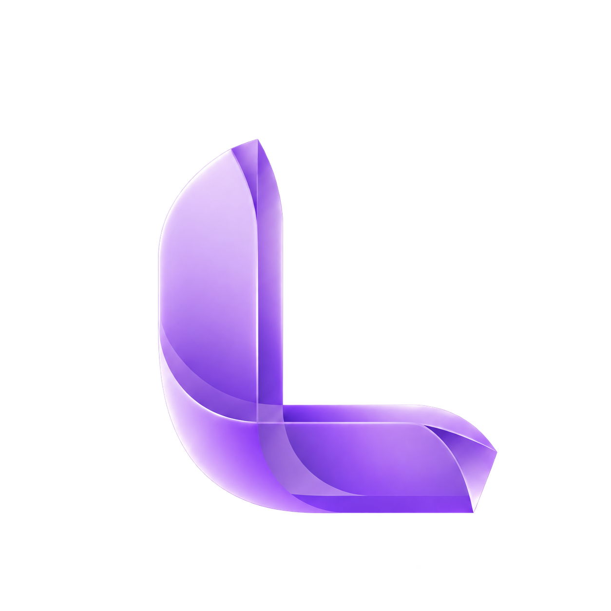
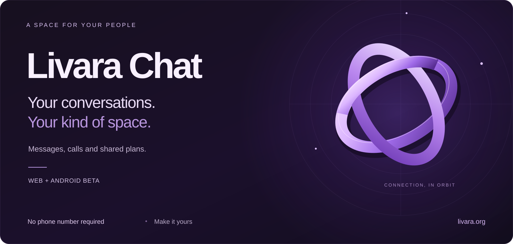
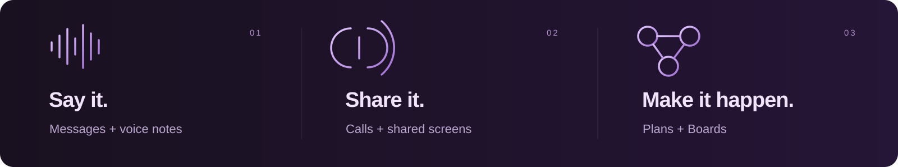
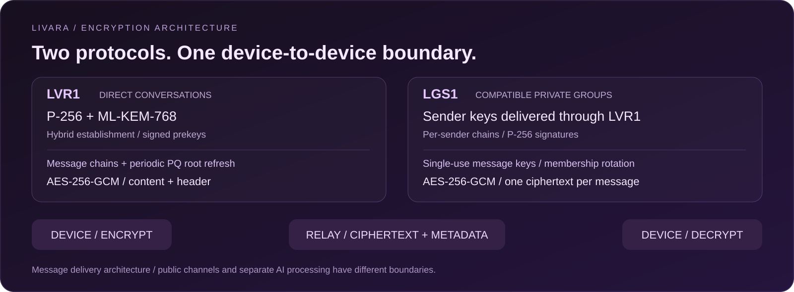

  

  <a href="README.md">English</a> · <b>فارسی</b>

# لیوارا چت — پیام‌رسان خصوصی برای وب و اندروید

گفت‌وگوهای هر روزتان، در فضایی به سلیقه خودتان. **لیوارا چت** پیام‌رسانی، گروه‌های خصوصی، تماس و برنامه‌ریزی مشترک را کنار هم می‌آورد؛ برای ثبت‌نام هم **نیازی به شماره تلفن نیست**. از مرورگر شروع کنید یا نسخه بتای اندروید را همراه خود داشته باشید. [با لیوارا آشنا شوید ←](https://livara.org)

**[ورود به لیوارا چت](https://chat.livara.org)** · **[دانلود بتای اندروید](https://livara.org/download)** · [لیوارا در یوتیوب](https://www.youtube.com/@Livara_Dev)

---

## کمی بیشتر از یک گفت‌وگو

| برای روزمره شما | چه کارهایی می‌توانید انجام دهید؟ |
| :--- | :--- |
| **گفت‌وگو را ادامه دهید** | پیام، یادداشت صوتی و فایل بفرستید؛ پاسخ دهید، واکنش بگذارید و ویرایش کنید. |
| **دوستان و نزدیکانتان را کنار هم بیاورید** | از چت مستقیم، گروه خصوصی، تماس صوتی و تصویری و اشتراک صفحه استفاده کنید. |
| **از حرف به برنامه برسید** | کارهای مشترک را با بوردها، کارت‌ها و چک‌لیست‌ها مرتب کنید. |
| **فضا را به سلیقه خود بسازید** | تم، رنگ، پس‌زمینه و تایپوگرافی را انتخاب کنید. |
| **هر وقت خواستید، کمک بگیرید** | ابزارهای هوش مصنوعی اختیاری‌اند. امکانات API هوش مصنوعی به Livara AI Pro نیاز دارند؛ پیش از به‌اشتراک‌گذاشتن محتوای گفت‌وگو با هوش مصنوعی، تنظیمات پردازش را بررسی کنید. |

[مشاهده امکانات](https://livara.org/features) · [اطلاعات هوش مصنوعی و پلن‌ها](https://livara.org)

## معماری رمزنگاری · LVR1 و LGS1

<b>نشست‌های ترکیبی پساکوانتومی؛ گفت‌وگوهای رمزنگاری‌شده از ابتدا تا انتها</b> ML-KEM-768 · P-256 · AES-256-GCM

بر اساس [معماری منتشرشده لیوارا](https://livara.org/security?lang=fa)، پروتکل **LVR1** گفت‌وگوی مستقیم را با **رمزنگاری سرتاسری ترکیبیِ پساکوانتومی (PQ E2EE)** محافظت می‌کند. **LGS1** برای گروه‌های خصوصی سازگار، زنجیره‌های امضاشده فرستنده دارد و کلیدهای آن‌ها را از طریق نشست‌های دونفره LVR1 توزیع می‌کند.

### LVR1 · یک نشست ترکیبی میان دو دستگاه

LVR1 مواد کلید کلاسیک و پساکوانتومی را ترکیب می‌کند. بخش پساکوانتومی با هدف مقاومت در برابر رمزگشایی آینده ترافیک ضبط‌شده با رایانه‌های کوانتومی طراحی شده؛ خودِ محتوای پیام با AES-256-GCM رمز می‌شود.

| لایه | طراحی منتشرشده |
| :--- | :--- |
| توافق کلید کلاسیک | P-256 ECDH همراه پیش‌کلیدهای امضاشده |
| توافق کلید پساکوانتومی | ML-KEM-768 با نوسازی دوره‌ای |
| برقراری نشست | روش ترکیبی مشابه X3DH؛ استفاده از کلید یک‌بارمصرف در صورت موجود بودن |
| تحول کلیدها | سازوکار دوجغجغه‌ای کلاسیک، زنجیره‌های مستقل ارسال و دریافت و ریشه دوره‌ای جداگانه ML-KEM |
| حفاظت پیام | ترکیب کلید پیام با ریشه پساکوانتومی فعلی؛ حفاظت محتوا و سرآیند با AES-256-GCM |
| پیوست‌ها | کلید تصادفی جدا برای هر فایل؛ انتقال کلید در نشست رمزنگاری‌شده |

**از ساخت هویت تا ارسال پیام:**

۱. **هویت روی دستگاه ساخته می‌شود.** کلید خصوصی P-256 و بذر ML-KEM-768 روی دستگاه تولید می‌شوند و به‌شکل خوانا بارگذاری نمی‌شوند.

۲. **پیش‌کلیدها بررسی می‌شوند.** برنامه امضای پیش‌کلیدهای P-256 و ML-KEM را بررسی می‌کند؛ کلیدهای یک‌بارمصرف نیز در صورت وجود به کار می‌روند.

۳. **نشست برقرار می‌شود.** چند توافق P-256 و راز مشترک ML-KEM، ریشه‌های مستقل کلاسیک و پساکوانتومی را ایجاد می‌کنند.

۴. **کلیدها پیش می‌روند.** زنجیره‌های یک‌طرفه ارسال و دریافت با پیام‌ها جلو می‌روند. به‌روزرسانی دوره‌ای ML-KEM ریشه پساکوانتومی را تازه می‌کند؛ برقراری کامل نشست برای تک‌تک پیام‌ها تکرار نمی‌شود.

۵. **پیام رمز و ارسال می‌شود.** AES-256-GCM محتوای محافظت‌شده را رمزنگاری و اصالت آن را بررسی می‌کند. سرور متن رمز‌شده را می‌رساند و دستگاه گیرنده آن را با کلید متناظر باز می‌کند.

### LGS1 · زنجیره امضاشده برای هر فرستنده گروه

هر فرستنده زنجیره مستقل خودش را دارد؛ بنابراین لازم نیست هر پیام عادی گروه جداگانه برای تک‌تک اعضا رمزنگاری شود.

| مرحله | چه اتفاقی می‌افتد؟ |
| :--- | :--- |
| ساخت | هر عضو زنجیره فرستنده و هویت امضای P-256 را روی دستگاه خود می‌سازد |
| توزیع | کلیدهای فرستنده از طریق نشست‌های دونفره پساکوانتومی LVR1 به اعضای دیگر می‌رسند |
| ارسال | هر جایگاه زنجیره یک کلید یک‌بارمصرف AES-256-GCM می‌سازد؛ پیام امضای فرستنده را همراه دارد |
| تحویل | یک نسخه رمز‌شده پیام میان اعضای گروه توزیع می‌شود |
| نوسازی | با ورود یا خروج اعضا، کلیدهای فرستنده تازه و دوباره توزیع می‌شوند |

**ارتباط با معماری پساکوانتومی:** رمز محتوای گروه در LGS1 از نوع AES-256-GCM است؛ توزیع کلیدهای فرستنده از حفاظت ترکیبی پساکوانتومی LVR1 بهره می‌برد. امضای فرستنده طبق توضیح سایت از نوع P-256 است.

پوشش گروه سازگار شامل **متن، ویرایش، عکس، ویدئو، فایل، پیام صوتی، توضیح و نام فایل و کلید پیوست** می‌شود. حذف عضو، محتوایی را که قبلاً روی دستگاهش دریافت کرده پاک نمی‌کند.

<b>مالکیت کلید، بازیابی و بررسی هویت</b>

کلیدهای خصوصی روی دستگاه کاربر ساخته می‌شوند. پشتیبان هویت پیش از بارگذاری رمزنگاری می‌شود و بازکردن آن به عبارت بازیابی نیاز دارد؛ گذرواژه حساب به‌تنهایی کافی نیست. بازیابی هویت، تاریخچه گفت‌وگو یا وضعیت نشست‌های رمزنگاری را برنمی‌گرداند. اثرانگشت کلید مخاطب را از مسیر مطمئن دیگری با او مقایسه کنید.

<b>محدوده حفاظت</b>

ساخت گروه رمزنگاری‌شده به آماده‌بودن همه اعضا نیاز دارد. گروه قدیمی ناسازگار با وضعیت مشخص خارج از E2EE می‌ماند؛ بدون هویت رمزنگاری نیز ارسال محافظت‌شده انجام نمی‌شود. کانال‌ها عمومی‌اند. اطلاعات مسیریابی، اعضا، زمان‌ها، اندازه متن رمز‌شده و وضعیت تحویل برای سرویس قابل مشاهده‌اند؛ LSS1 در ارسال عادی پیام فعال نیست.

دستگاه باز یا آلوده و اقدامات گیرنده می‌توانند متن خوانا را افشا کنند. ضبط اختیاری تماس روی سرور با نشان **REC**، تماس را به رمزنگاری مسیر انتقال تغییر می‌دهد. پردازش جداگانه هوش مصنوعی تابع تنظیمات برنامه و سیاست حریم خصوصی است.

[معماری](https://livara.org/security?lang=fa) · [مدل تهدید](https://livara.org/threat-model) · [آزمایش‌های محلی رمزنگاری](https://livara.org/proof)

## اولین سلام

۱. **پلتفرم را انتخاب کنید.** [نسخه وب](https://chat.livara.org) را باز کنید یا APK فعلی را از [صفحه دانلود اندروید](https://livara.org/download) بگیرید.

۲. **حساب بسازید.** نام کاربری و گذرواژه کافی است؛ شماره تلفن لازم نیست.

۳. **اطلاعات بازیابی را امن نگه دارید.** گذرواژه به‌تنهایی کلیدهای رمزنگاری را بازیابی نمی‌کند. راهنمای فعلی راه‌اندازی و بازیابی را دنبال کنید.

۴. **گفت‌وگو را شروع کنید.** دوستان و نزدیکانتان را دعوت کنید، تم دلخواه را انتخاب کنید و راحت باشید.

در اندروید، SHA-256 فایل APK را با مقدار منتشرشده برای **همان نسخه** در [صفحه دانلود](https://livara.org/download) مقایسه کنید. تطبیق هش، یکپارچگی فایل را نسبت به آن مقدار می‌سنجد.

## پرسش‌های کوتاه

### آیا لیوارا بدون شماره تلفن کار می‌کند؟
بله؛ ثبت‌نام با نام کاربری و گذرواژه انجام می‌شود. [معرفی حساب کاربری](https://livara.org)

### لیوارا چت روی چه پلتفرم‌هایی در دسترس است؟
در مرورگر و نسخه بتای اندروید. نیازمندی‌ها و جزئیات نسخه فعلی را در [صفحه دانلود](https://livara.org/download) ببینید.

### آیا این مخزن، کد برنامه را در اختیار می‌گذارد؟
این مخزن برای **معرفی محصول و مستندات** است. کد منبع برنامه لیوارا چت در آن قرار ندارد و مجوز نرم‌افزاری اعطا نمی‌کند.

---

**با یک سلام شروع کنید.**

[ورود به لیوارا چت](https://chat.livara.org) · [وب‌سایت](https://livara.org) · [امنیت](https://livara.org/security) · [Proof Lab](https://livara.org/proof) · [یوتیوب](https://www.youtube.com/@Livara_Dev)

تصاویر، طرح معرفی برند هستند؛ نه اسکرین‌شات محصول. اطلاعات بر اساس مستندات عمومی لیواراست و دسترسی به امکانات ممکن است تغییر کند.

